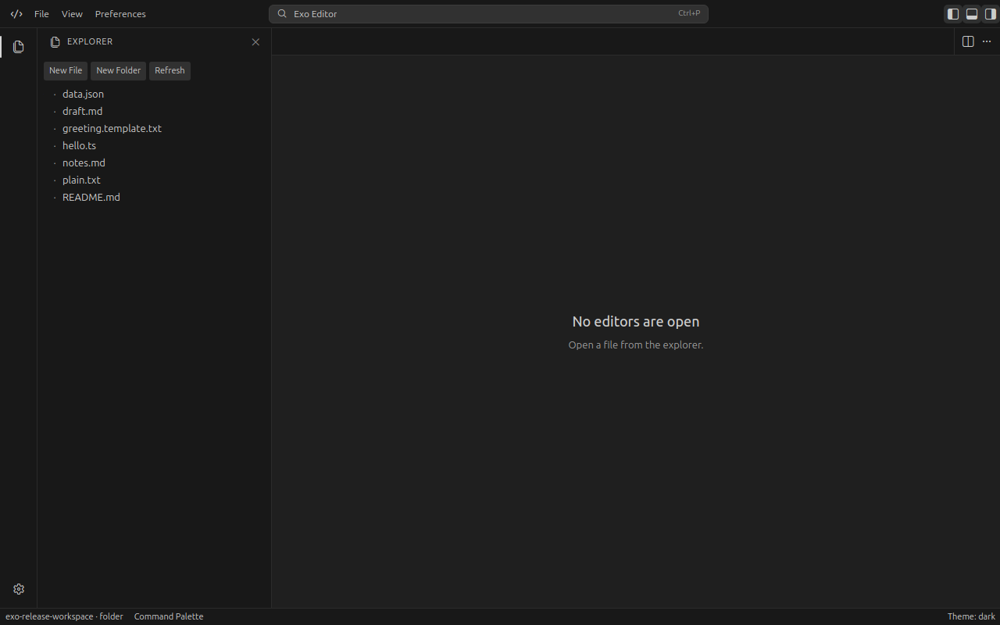
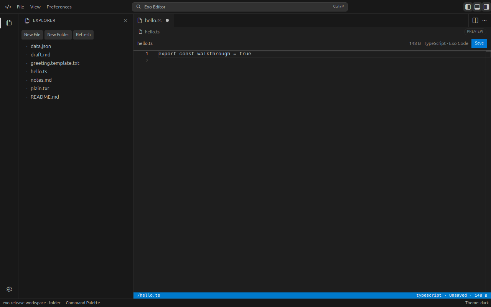
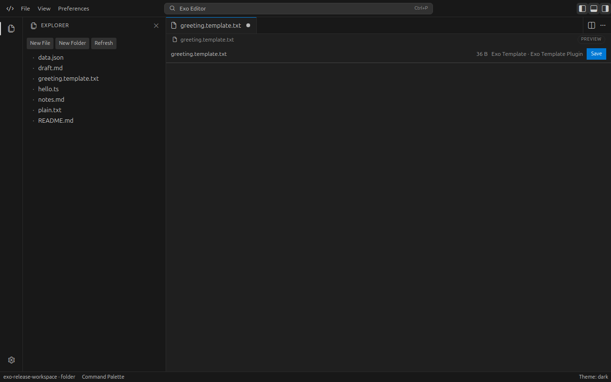
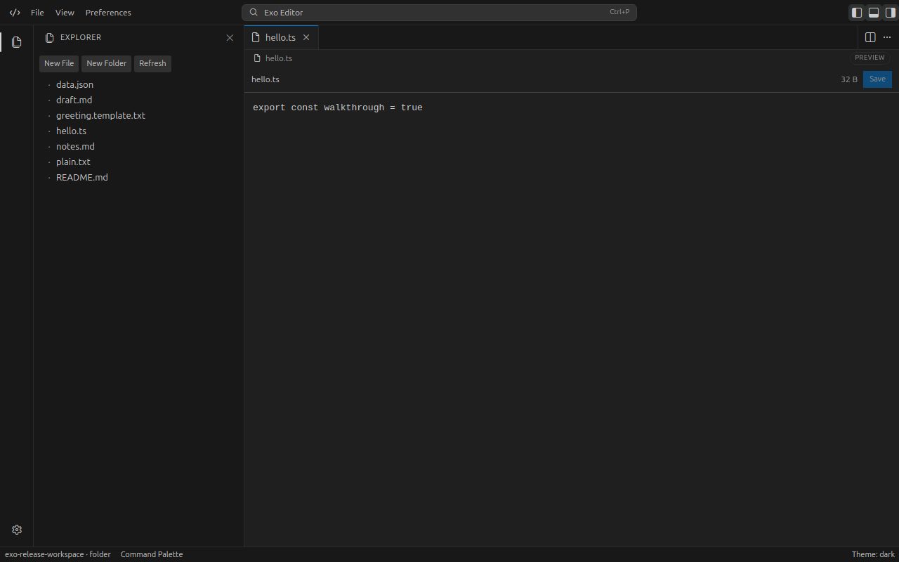

# Walkthrough

Status: recorded acceptance path for the v1 release. Every screenshot comes from
the deployed URL below, not a local dev server or local build.

## Provenance

- Deployed URL: `https://mode777.github.io/exo-editor/`
- Deployed commit: `90172af`
- Capture date: 2026-11-16
- Browser: Chrome for Testing 131.0.6778.264, 1280x800
- Workspace: `examples/demo-workspace/` mounted through a `showDirectoryPicker`
  stub over an OPFS handle (the layer 5-9 verification method)

## Steps

1. **Open the deployed shell.** Load the URL and confirm the workbench renders
   with no workspace. The explorer says a folder must be opened and offers Open
   Folder and Connect Remote.
2. **Open the demo workspace.** Choose Open Folder and select the demo folder.
   The explorer lists `data.json`, `draft.md`, `greeting.template.txt`,
   `hello.ts`, `notes.md` and `plain.txt`; `exo.json` is not shown as a document.
3. **Approve consent.** Two dialogs appear in declaration order: Exo Code then
   Exo Template. Both show the same-origin warning; Exo Code also shows the
   frame-rendering disclosure. Approve both. The plugin log records
   `active` for each and no iframe remains from registration.
4. **Edit with the code plugin.** Open `hello.ts`. A visible Monaco surface
   appears inside the document area; the tab, breadcrumbs and Save action stay
   shell chrome. Type a change; the tab shows a dirty dot. Press Ctrl/Cmd+S or run
   File > Save. The file writes and the dot clears. Reload and reopen `hello.ts`;
   the change is still there.
5. **Check JSON and Markdown.** Open `data.json` and `notes.md`. Each opens in
   Monaco with the JSON and Markdown language selected. The same editor surface
   is reused across tabs.
6. **Use the template plugin.** Open `greeting.template.txt`. The hidden template
   editor handles it; edit and save, and the file contains the original text
   plus `[template save 1]`.
7. **Use the shell text surface.** Open `plain.txt`. It opens in the shell's
   own text area, not a plugin frame. Edit and save; the exact text persists.
8. **Check unsaved changes.** Open `draft.md`, edit it, and close the tab. The
   shell offers Save, Discard and Cancel. Cancel keeps the tab and buffer;
   Discard closes without writing.
9. **Change the theme.** Toggle the theme from the palette. Monaco follows to
   the other theme without reopening the file; the event reaches the subscribed
   handler.
10. **Disable a plugin.** Open Extensions, select Exo Code, choose Disable, and
    open `hello.ts`. The file falls back to the shell text surface and no
    visible plugin frame remains. Re-enable it and confirm the Monaco surface
    returns on the next open. Open Settings and confirm the **Plugin debugging**
    section keeps raw `exo.json`, status and the log without duplicating the
    Extensions actions.
11. **Check the unsupported folder state.** Open the shell in a browser without
    `showDirectoryPicker` (or emulate its absence). The explorer explains the
    limitation, does not show a mock tree, and still offers Connect Remote.
12. **Switch workspaces.** Open a second folder, then switch back to the demo.
    No tab, plugin frame, handler or log entry from the previous visit remains;
    consent stays approved.
13. **Open a plugin panel and content view.** Add the deployed plugin-host
    fixture manifest (`/plugin-host-fixture/exo-manifest.json`) to a scratch
    workspace, approve it, and reveal its primary, secondary and bottom panels.
    The activity item and chrome name the plugin; the secondary picker switches
    views without a new handshake. Open its content view: a read-only tab with no
    Save or dirty state, a bounded payload, and a frame that is disposed when the
    tab closes. A second plugin opens the same content view and receives
    `openedBy`; it cannot read the target's state or events.
14. **Run plugin commands.** With the fixture active, open a text file matched by
    `**/*.txt`. The document action row above the editor offers Format Fixture and
    names the plugin. Use it: the fixture records the invocation and the status
    notice stays silent on success. Run Generate Fixture Report from the explorer
    context menu on a file and on a folder: the panel is revealed (lazily on the
    first run), the fixture records `{ path, kind }`, and the menu shows at most
    ten plugin entries. Run Inspect Fixture View: one content-view tab opens and
    focuses rather than a second tab. Run Fail Fixture Command: a plain-text
    notice names the plugin and can be dismissed. Disable the fixture: every
    palette, menu and action entry disappears and no new invocation reaches its
    frames.
15. **Create a new file.** With the fixture active in a writable workspace, open
    the explorer New File menu: it offers Empty File and the fixture templates
    under the plugin name. Choose a text template; the Save As dialog names the
    plugin, starts in the selected folder, pre-fills the default name, shows the
    size and a bounded preview. Confirm: the file is created create-only and
    opens. Repeat with an existing name and confirm the collision keeps the
    dialog open and leaves the existing content unchanged. Choose a binary
    template and confirm the dialog shows a byte size and no preview. Invoke a
    content view that asks the shell to create a file; it gets the path and
    version, the shell does not open a tab, and Escape cancels without a write.
16. **Check content-view companions.** With the fixture active, open Fixture
    Tutorial from the palette. The right side bar reveals Fixture Inspector and
    the read-only tab renders. Hide the inspector: it stays hidden while the tab
    remains active. Refocus the tab and it returns. Switch to a file tab: the
    inspector hides, and returning to the content tab reveals it again. Open
    Fixture Tutorial twice from the palette, then switch between the two tabs:
    the inspector stays visible and follows the active tab. Close one tab; the
    companion hides if its tab is no longer active and returns when the remaining
    tab becomes active. Select another secondary view before closing the last
    tab: that other panel stays visible. Open Fixture Gallery: the primary,
    secondary and bottom companions reveal together, and switching to a plain
    file hides those regions. No plugin heartbeat, polling or extra lifecycle
    message is involved.
17. **Check file-editor companions.** With the fixture active, create or open
    `demo.companion.txt`. Once its handler is active, the primary Fixture Panel,
    secondary Fixture Inspector 2 and bottom Fixture Inspection reveal. Switch
    to `notes.txt`: all three hide. Return to the editor: they reveal again.
    Hide Fixture Inspector 2 and stay on the tab: unrelated updates do not reopen
    it; leave and return and it comes back. Open a second `*.companion.txt` file:
    the companions stay visible for the same contribution. Open a file handled
    by another fixture editor: the panels that contribution does not declare
    hide. Disable the fixture: the companions hide and their frames are disposed
    with the plugin.
18. **Follow the active editor from a bottom panel.** With the fixture active,
    open a `*.bound.txt` file. The bottom region shows Fixture Inspection and the
    panel records the active path and instance id. Open a second `*.bound.txt`
    file and switch tabs: the panel follows the active tab and the inactive
    editor is not advertised. Choose **Apply panel edit**: the active editor
    appends the text, the tab becomes dirty and the panel records the applied
    snapshot. Choose **Undo panel edit**: the editor restores its previous buffer
    and stays dirty. Save with the tab's Save action and confirm the normal
    fixture marker is written; the panel has no save or write action. Switch to
    `notes.txt` or the other plugin's editor: the panel shows its empty state.
    Close and reopen the bottom region: the retained frame returns without a new
    handshake, and an inactive bottom tab creates no iframe.
19. **Discover and install from the marketplace.** With the deployed shell and
    no workspace, open Extensions (`Ctrl+Shift+X`). The Marketplace section
    loads the official feed and lists Exo Code and Exo Template Plugin with
    source **Exo Plugins**; the Installed section explains that a folder is
    required. Type `template` in the search field and confirm only the template
    listing remains, then clear it. Open a scratch folder with no `exo.json` and
    open Extensions again. Choose Install on Exo Template Plugin: the details tab
    opens, `exo.json` contains one enabled `manifest` entry and the normal
    consent dialog names
    `https://mode777.github.io/exo-editor/plugin-template/exo-manifest.json`.
    Approve it; the details show the manifest name, publisher, origin,
    permissions, contributions and declared settings. Disable, enable and remove
    it from details and confirm the Installed section and `exo.json` follow.
    Confirm the settings **Plugin debugging** section shows the same entry's
    status and log but no install/remove/consent controls. Open Extensions in a
    read-only workspace: install and manage actions are disabled and explained.
    Point a scratch deployment at a missing or invalid source file and confirm
    the error/Retry state while installed rows and install by URL still work.

## Screenshots

The committed images live in `docs/media/walkthrough/`:

The template handler's observation during the capture recorded one read of 36
bytes, `saves: [1]` with `lastSave.ok` and the rotated version, and the frame was
removed when the tab closed. The code plugin round-tripped
`export const walkthrough = true`, and the shell text surface saved the edited
`plain.txt`.
