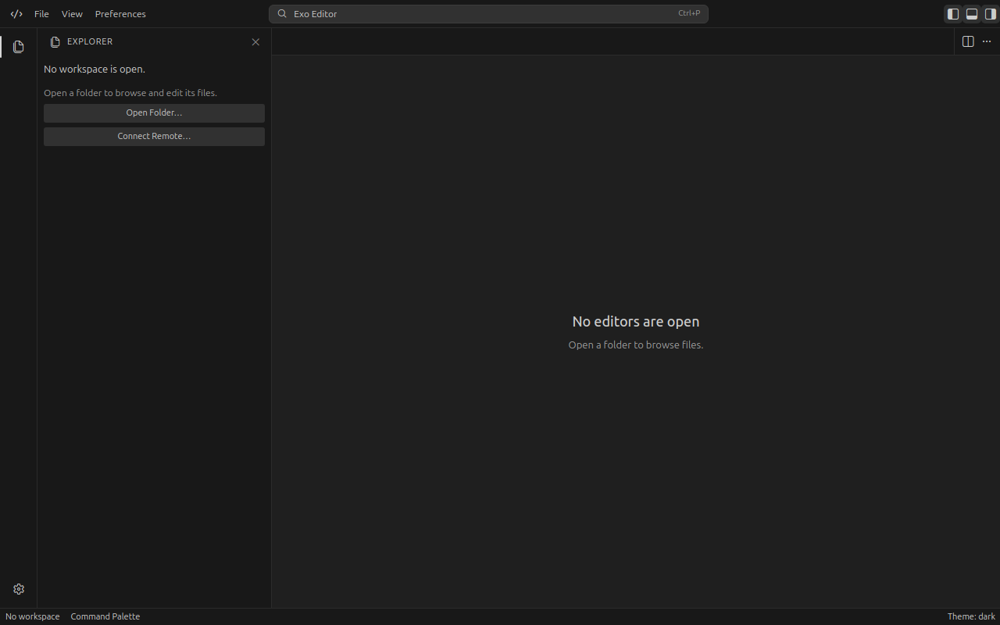
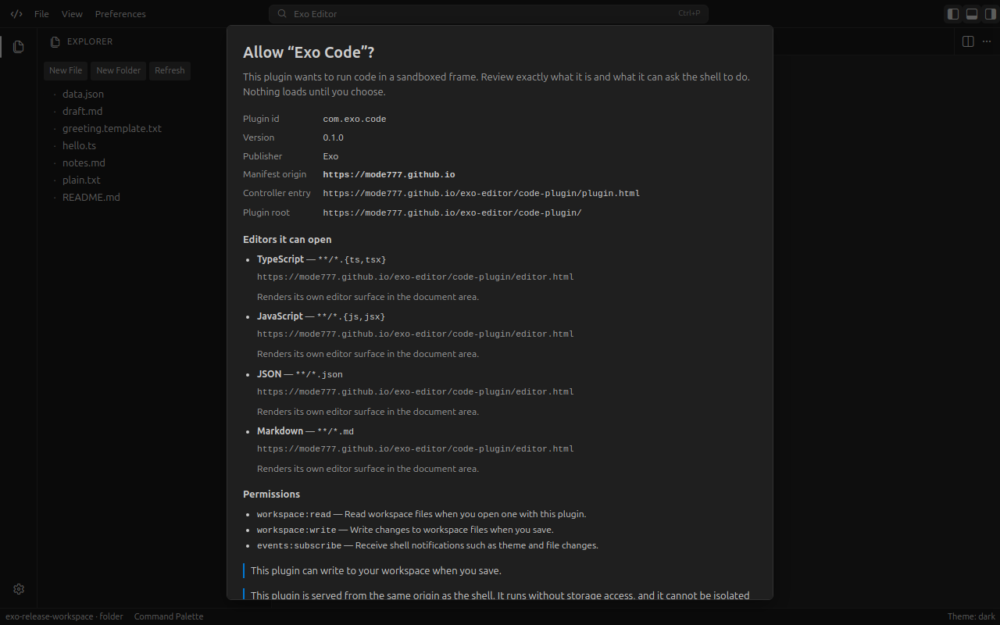
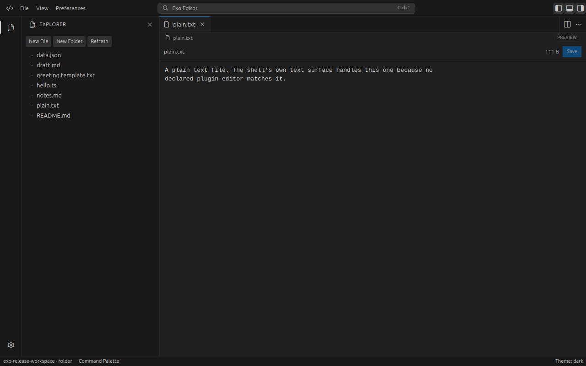
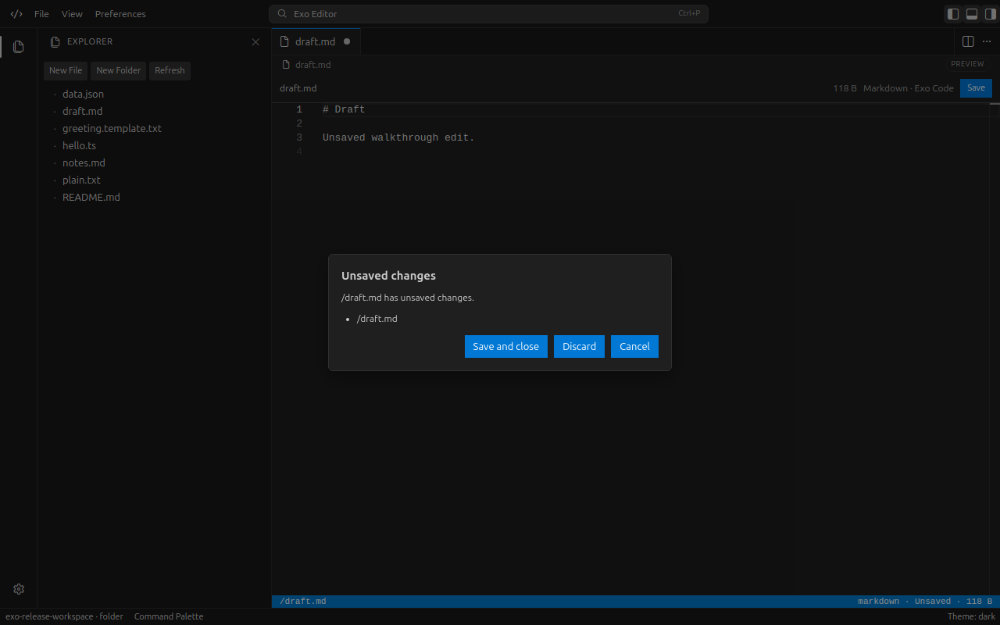
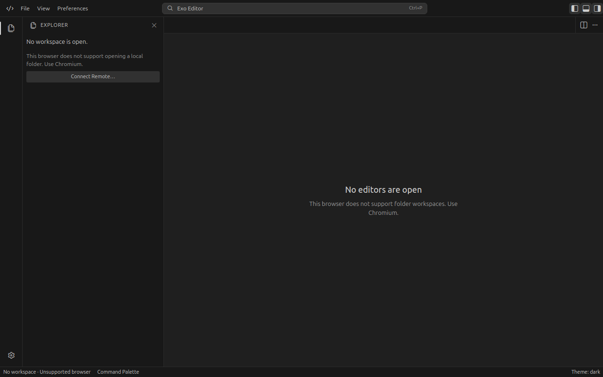

# Walkthrough

Status: recorded acceptance path for the v1 release. Every screenshot comes from
the deployed URL below, not a local dev server or local build.

## Provenance

- Deployed URL: `https://mode777.github.io/exo-editor/`
- Deployed commit: `90172af`
- Capture date: 2026-11-16
- Browser: Chrome for Testing 131.0.6778.264, 1280x800
- Workspace: `examples/demo-workspace/` mounted through a `showDirectoryPicker`
  stub over an OPFS handle (the layer 5-9 verification method)

## Steps

1. **Open the deployed shell.** Load the URL and confirm the workbench renders
   with no workspace. The explorer says a folder must be opened and offers Open
   Folder and Connect Remote.
2. **Open the demo workspace.** Choose Open Folder and select the demo folder.
   The explorer lists `data.json`, `draft.md`, `greeting.template.txt`,
   `hello.ts`, `notes.md` and `plain.txt`; `exo.json` is not shown as a document.
3. **Approve consent.** Two dialogs appear in declaration order: Exo Code then
   Exo Template. Both show the same-origin warning; Exo Code also shows the
   frame-rendering disclosure. Approve both. The plugin log records
   `active` for each and no iframe remains from registration.
4. **Edit with the code plugin.** Open `hello.ts`. A visible Monaco surface
   appears inside the document area; the tab, breadcrumbs and Save action stay
   shell chrome. Type a change; the tab shows a dirty dot. Press Ctrl/Cmd+S or run
   File > Save. The file writes and the dot clears. Reload and reopen `hello.ts`;
   the change is still there.
5. **Check JSON and Markdown.** Open `data.json` and `notes.md`. Each opens in
   Monaco with the JSON and Markdown language selected. The same editor surface
   is reused across tabs.
6. **Use the template plugin.** Open `greeting.template.txt`. The hidden template
   editor handles it; edit and save, and the file contains the original text
   plus `[template save 1]`.
7. **Use the shell text surface.** Open `plain.txt`. It opens in the shell's
   own text area, not a plugin frame. Edit and save; the exact text persists.
8. **Check unsaved changes.** Open `draft.md`, edit it, and close the tab. The
   shell offers Save, Discard and Cancel. Cancel keeps the tab and buffer;
   Discard closes without writing.
9. **Change the theme.** Toggle the theme from the palette. Monaco follows to
   the other theme without reopening the file; the event reaches the subscribed
   handler.
10. **Disable a plugin.** Open Settings, disable Exo Code, and open `hello.ts`.
    The file falls back to the shell text surface and no visible plugin frame
    remains. Re-enable it and confirm the Monaco surface returns on the next
    open.
11. **Check the unsupported folder state.** Open the shell in a browser without
    `showDirectoryPicker` (or emulate its absence). The explorer explains the
    limitation, does not show a mock tree, and still offers Connect Remote.
12. **Switch workspaces.** Open a second folder, then switch back to the demo.
    No tab, plugin frame, handler or log entry from the previous visit remains;
    consent stays approved.
13. **Open a plugin panel and content view.** Add the deployed plugin-host
    fixture manifest (`/plugin-host-fixture/exo-manifest.json`) to a scratch
    workspace, approve it, and reveal its primary and secondary panels. The
    activity item and chrome name the plugin; the secondary picker switches
    views without a new handshake. Open its content view: a read-only tab with no
    Save or dirty state, a bounded payload, and a frame that is disposed when the
    tab closes. A second plugin opens the same content view and receives
    `openedBy`; it cannot read the target's state or events.

## Screenshots

The committed images live in `docs/media/walkthrough/`:

The template handler's observation during the capture recorded one read of 36
bytes, `saves: [1]` with `lastSave.ok` and the rotated version, and the frame was
removed when the tab closed. The code plugin round-tripped
`export const walkthrough = true`, and the shell text surface saved the edited
`plain.txt`.
